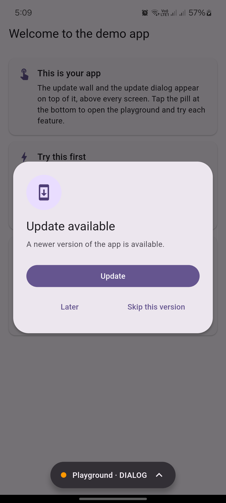
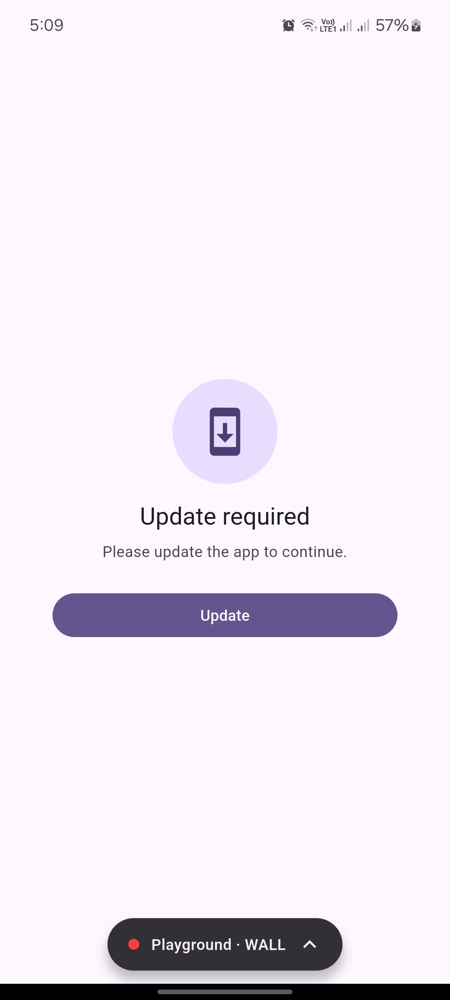
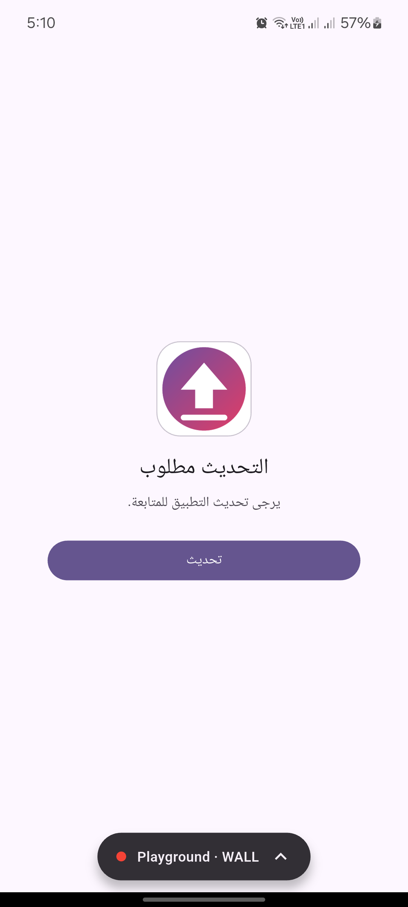

# adaptable_remote_config

[](https://pub.dev/packages/adaptable_remote_config)

Tell old versions of your app to update, **without releasing a new app**.

- **Force update:** old versions see a full-screen wall. They must update to continue.
- **Optional update:** old versions see a small dialog. They can tap *Later* or *Skip*.

You change a few values on a server. The app reads them and decides what to show.
Works on Android and iOS.

<p align="center">
  
  
  
</p>

---

## Try it first (no setup, no server)

This repository has a **full example app**: a playground where you change the "server" values,
pick a look, fake the store, and watch the wall, the dialog and the logs react. It needs no
Firebase and no server.

**On an Android phone:** download `adaptable_remote_config_example.apk` from the
[latest release](https://github.com/Abdelrahman1atef/adaptable_remote_config/releases/latest)
and install it. (Android asks you to allow installs from your browser.)

**On your computer:** run it from the source. It works on Android, iOS, web, Windows, macOS
and Linux:

```sh
git clone https://github.com/Abdelrahman1atef/adaptable_remote_config.git
cd adaptable_remote_config/example
flutter run
```

Then, in the app: tap the pill at the bottom, tap **Optional update** (a dialog appears),
then **Force update** (the wall appears). The playground stays usable over the wall, and the
**Logs** tab shows why each decision was made. The [example's README](example/README.md)
lists everything you can try.

---

## Install

This is a **Flutter** package, for **Android and iOS** apps. It does **not** work in plain
Dart projects (command-line tools, servers), because it needs the Flutter SDK.

**You need:** Flutter 3.32 or newer. Check with `flutter --version`.

**1. In your Flutter app's folder** (the one with `pubspec.yaml`), run:

```sh
flutter pub add adaptable_remote_config
```

(or add `adaptable_remote_config: ^0.7.1` under `dependencies:` in `pubspec.yaml` and run
`flutter pub get`).

**2. Import it:**

```dart
import 'package:adaptable_remote_config/adaptable_remote_config.dart';
```

**3. Set it up.** The quickest way is the setup tool (next section). It is a command that
comes with this package. You run it with `dart run` **from your Flutter app's folder**; the
`dart` command is part of Flutter, so there is nothing else to install.

If you use **Firebase**, your app must also be connected to Firebase (`firebase_core`
and `flutterfire configure`). The setup tool helps with that too.

---

## How it works (60 seconds)

```
 1. YOU change a value          "minimum version is now 2.0.0"
        │                        (in Firebase, in a JSON file, or in your own code)
        ▼
 2. The app reads it            when it starts, and again when it comes back
        │                        to the screen after about an hour
        ▼
 3. The app compares            installed version  vs  the version you set
        │
        ▼
 4. It decides                  fine  →  nothing happens
                                a bit old  →  optional dialog
                                too old  →  force-update wall
```

Three things are involved:

| Piece | What it is |
| --- | --- |
| **Source** | Where your values live. You pick one (see below). |
| **Controller** | Reads the values and decides. You create one. |
| **UpdateGate** | A widget around your app. It shows the wall or dialog. |

If the app cannot reach the source (no internet), it uses the last values it saved.
If there is nothing saved, it lets the user in. **It never blocks users by mistake.**

> **Not sure what a value will do?** See the
> [decision table](#what-will-the-user-see-the-decision-table): it shows, for every
> combination of values, what the user will see.

---

## Step 0: Pick your method

| Method | Choose it if... | Needs |
| --- | --- | --- |
| **1. Firebase** | You already use Firebase, or you want the easiest way to edit values. | A Firebase project |
| **2. A JSON file** | You do not use Firebase. You can put a small file on any website. | A place to host a file |
| **3. Your own code** | You already have a backend API with app settings. | An API that returns settings |

Not sure? Choose **Firebase**.

---

## The fast way: let the setup tool do it

After *Install* above, run this in your Flutter app folder:

```sh
dart run adaptable_remote_config
```

The tool asks a few questions. Use the **arrow keys**, **space** and **Enter**.
Then it:

1. Writes `lib/app_update.dart` (the controller).
2. Wraps your `MaterialApp` with `UpdateGate`.
3. For Firebase: starts Firebase in `main()`, and adds `firebase_core` if missing.
4. For Firebase: creates the values in your Firebase project (it shows them first and asks).
   If you give the app a **prefix**, it puts the values in their own **folder** in the
   Firebase console (see *Two apps in one Firebase project* below).

It never changes a value that already exists. If it cannot edit a file safely, it
leaves the file alone and shows you the few lines to add yourself.

**No questions at all:**

```sh
dart run adaptable_remote_config --yes
```

More options:

| Option | What it does |
| --- | --- |
| `--source firebase` (or `http`, `custom`) | Choose the method without being asked |
| `--mode both` (or `force`, `optional`) | Choose the update types without being asked |
| `--url https://...` | The JSON file address (for `http`) |
| `--play-update` | Android: the Update button starts Google Play's own update screen (see *Let the store do the update*) |
| `--no-play-update` | Android: the Update button opens the store page (the default) |
| `--icon assets/images/logo.png` | Show your app icon on the update screens (writes `appIcon:` for you) |
| `--no-icon` | Do not show an app icon |
| `--publish` | Create the Firebase values without asking |
| `--no-publish` | Do not touch Firebase, only print the values to create |
| `--prefix customer` | Several apps in one Firebase project: name the keys `customer_android_version`... (see below) |
| `--group "Customer app"` | Put the keys in this Firebase console folder (default: the prefix) |
| `--no-group` | Do not use a console folder |
| `--project my-project-id` | Choose the Firebase project |
| `--dir path` / `--out path` | Choose the app folder / the file to write |

With `--yes`, nothing is written to your Firebase project unless you add `--publish`.

**One more thing, for your own logo:** pass `--icon assets/images/logo.png` (your own file) to show it
on the update screens. See *Show your app icon on the update screens* below.

Prefer to do it yourself? Follow your method below.

---

## Show your app icon on the update screens

The wall and the dialog can show **your app icon** at the top. You choose the picture, and
**there is no fixed path or file name**. You hand it to `UpdateGate`.

**1. Put the picture in your app,** anywhere you like, for example
`assets/images/logo.png`. Use a **square PNG** (`512 x 512` is perfect), such as your
launcher icon or brand logo on a white background.

**2. Tell Flutter about the file.** In your app's `pubspec.yaml`:

```yaml
flutter:
  assets:
    - assets/images/logo.png     # or the whole folder:  - assets/images/
```

**3. Pass it to the gate:**

```dart
MaterialApp(
  builder: (context, child) => UpdateGate(
    controller: AppUpdate.controller,
    appIcon: const AssetImage('assets/images/logo.png'),
    child: child!,
  ),
)
```

**4. Stop the app and run it again.** (A new asset needs a restart, not a hot reload.)

The icon now appears on the force-update wall and on the optional dialog, on a white
rounded tile (bigger on the wall).

**The easy way:** let the setup tool do steps 2 and 3 for you:

```sh
dart run adaptable_remote_config --icon assets/images/logo.png
```

It checks that the file exists, writes `appIcon:` into your `UpdateGate`, and tells you if
the file is not listed in `pubspec.yaml`. If you do not pass `--icon`, it looks for a file
named `app_icon.png`, `icon.png` or `logo.png` in `assets/` or `assets/images/` and offers
it. Use `--no-icon` to skip.

| What you pass | What you see |
| --- | --- |
| `appIcon: AssetImage(...)` and the file loads | **Your app icon** |
| nothing | A round "update" icon |
| `appIcon:` but the file is missing or broken | A round "update" icon (no error, nothing breaks) |

**An icon from the internet:**

```dart
appIcon: const NetworkImage('https://example.com/icon.png'),
```

**An SVG, an animation, or any widget** (use `iconBuilder`; it wins over `appIcon`):

```dart
UpdateGate(
  controller: AppUpdate.controller,
  iconBuilder: (context, size) => SvgPicture.asset('assets/logo.svg', width: size),
  child: child!,
)
```

`size` is the space the default layout gives the icon: `64` on the dialog and `96` on the
wall. Want to change more than the icon? See *Change the look* below.

---

# Method 1: Firebase

## What you need

- A Flutter app connected to Firebase (`flutterfire configure` done once).
- The packages `firebase_core` and `adaptable_remote_config`.

## How it works

Firebase Remote Config stores a list of named values (like `android_version`).
You edit them in the Firebase website. The app downloads them. No app release needed.

## Steps

**1. Add the packages**

```sh
flutter pub add adaptable_remote_config firebase_core
```

**2. Connect your app to Firebase (once)**

```sh
dart pub global activate flutterfire_cli
flutterfire configure
```

This creates `lib/firebase_options.dart`.

**3. Start Firebase in `main()`**

```dart
import 'package:firebase_core/firebase_core.dart';
import 'firebase_options.dart';

Future<void> main() async {
  WidgetsFlutterBinding.ensureInitialized();
  await Firebase.initializeApp(options: DefaultFirebaseOptions.currentPlatform);
  runApp(const MyApp());
}
```

**4. Create `lib/app_update.dart`**

```dart
import 'package:adaptable_remote_config/adaptable_remote_config.dart';

class AppUpdate {
  AppUpdate._();

  static final RemoteConfigController controller = RemoteConfigController(
    appId: 'my_app', // any name; it labels the saved copy on the phone
    provider: FirebaseConfigProvider(
      // The values used when Firebase has nothing yet. These change nothing.
      defaults: const {
        'android_version': '1.0.0+1',
        'ios_version': '1.0.0+1',
        'force_update': false,
        'android_latest_version': '1.0.0+1',
        'ios_latest_version': '1.0.0+1',
        'android_store_link': '',
        'ios_store_link': '',
      },
    ),
    subscribeToChanges: true,
  );
}
```

**5. Wrap your app with `UpdateGate`**

```dart
MaterialApp(
  builder: (context, child) => UpdateGate(
    controller: AppUpdate.controller,
    child: child!,
  ),
  // ...
)
```

(Use the same `builder:` on `MaterialApp.router`.) If you already have a `builder:`,
call `UpdateGate(...)` inside it, around the widget it returns.

**6. Create the values in Firebase**

Firebase console → **Remote Config** → **Add parameter**. Create these:

| Name | Type | Start with | Meaning |
| --- | --- | --- | --- |
| `android_version` | String | `1.0.0+1` | Oldest Android version allowed |
| `ios_version` | String | `1.0.0+1` | Oldest iOS version allowed |
| `force_update` | Boolean | `false` | `true` turns on the force-update wall |
| `android_latest_version` | String | `1.0.0+1` | Newest Android version (for the optional dialog) |
| `ios_latest_version` | String | `1.0.0+1` | Newest iOS version |
| `android_store_link` | String | *(empty)* | Play Store link. Empty = the app finds it itself |
| `ios_store_link` | String | *(empty)* | App Store link. **Required for iOS** |

Press **Publish changes**. (The setup tool can create all of these for you.)

**7. Run the app.** Nothing should change yet. That is correct.

## Test it

(What will each value do? See the [decision table](#what-will-the-user-see-the-decision-table).)

| I want to... | Set this in Firebase, then Publish changes |
| --- | --- |
| See the **optional dialog** | `android_latest_version` = a number **higher** than your installed version, e.g. `9.0.0+1` |
| See the **force wall** | `android_version` = `9.0.0+1` **and** `force_update` = `true` |
| Go back to normal | Put the old values back (`1.0.0+1` and `false`) and publish |

Then **close the app fully and open it again**. Users get the change the next time they
start the app, usually within an hour (Firebase keeps a copy for up to an hour).

> **Careful:** Firebase has no test mode. A force-update value reaches **all** your
> users. Test with the *optional* dialog first.

> **Tested it once and now the dialog does not come back?** You probably tapped *Skip this version*
> or *Later*, and the phone remembers it. Use a higher `android_latest_version` each time you test,
> or call `AppUpdate.controller.forgetPromptAnswers()` once. The logs will say `shown: NO`.

## Two apps in one Firebase project? Give each app a prefix

Many teams use **one** Firebase project for several apps (for example a *customer* app
and a *driver* app). They would all read the same names, such as `android_version`, and
change each other. A **prefix** fixes this: each app gets its own names, and its own
**folder** in the Firebase console.

```
Firebase console → Remote Config
 ├── 📁 customer          ← customer app
 │     customer_android_version
 │     customer_ios_version
 │     customer_force_update
 │     ...
 └── 📁 driver            ← driver app
       driver_android_version
       driver_ios_version
       driver_force_update
       ...
```

**The easy way.** In each app, run the setup tool with its own prefix:

```sh
dart run adaptable_remote_config --prefix customer     # in the customer app
dart run adaptable_remote_config --prefix driver       # in the driver app
```

It creates the keys with that prefix **inside a folder with the same name**. (You can
also answer the questions: choose *With a prefix*, then type the prefix and the folder.)
Keys that already exist are never changed.

**By hand.** Do this for each app:

1. Choose a short prefix: lowercase letters, digits and `_` only (`customer`, `driver`).
2. In `lib/app_update.dart`, tell the controller the prefix, and use the prefixed names
   in `defaults`:

   ```dart
   static final RemoteConfigController controller = RemoteConfigController(
     appId: 'customer',
     keys: const UpdateKeys.prefixed('customer'),
     provider: FirebaseConfigProvider(
       defaults: const {
         'customer_android_version': '1.0.0+1',
         'customer_ios_version': '1.0.0+1',
         'customer_force_update': false,
         'customer_android_latest_version': '1.0.0+1',
         'customer_ios_latest_version': '1.0.0+1',
         'customer_android_store_link': '',
         'customer_ios_store_link': '',
       },
     ),
     subscribeToChanges: true,
   );
   ```

3. In the Firebase console, open **Remote Config**, choose **Add new → Parameter group**,
   and name it `customer`.
4. Add the seven keys above to that group (same types as in step 6), then
   **Publish changes**.

Each app now only reads its own keys, so changing the driver app never touches the
customer app.

---

# Method 2: A JSON file

## What you need

- A small text file on any website (your server, GitHub Pages, Firebase Hosting...).
- The address must start with `https://`.

## How it works

The app downloads your file when it starts. You edit the file to change the values.

## Steps

**1. Add the package**

```sh
flutter pub add adaptable_remote_config
```

**2. Create the file** (for example `app_config.json`) and upload it:

```json
{
  "android": {
    "minimum_version": "1.0.0+1",
    "latest_version": "1.0.0+1",
    "force_update": false,
    "store_url": "https://play.google.com/store/apps/details?id=com.example.app"
  },
  "ios": {
    "minimum_version": "1.0.0+1",
    "latest_version": "1.0.0+1",
    "force_update": false,
    "store_url": "https://apps.apple.com/app/id1234567890"
  }
}
```

**3. Create `lib/app_update.dart`**

```dart
import 'package:adaptable_remote_config/adaptable_remote_config.dart';

class AppUpdate {
  AppUpdate._();

  static final RemoteConfigController controller = RemoteConfigController(
    appId: 'my_app',
    provider: HttpConfigProvider(
      url: Uri.parse('https://example.com/app_config.json'),
    ),
    keys: const UpdateKeys.nested(), // tells the app your file uses "android": {...}
  );
}
```

If your file is inside another object, for example `{"data": {"app": {...}}}`,
add `root: 'data.app'` to `HttpConfigProvider`.

**4. Wrap your app with `UpdateGate`** (same as Firebase, step 5):

```dart
MaterialApp(
  builder: (context, child) => UpdateGate(
    controller: AppUpdate.controller,
    child: child!,
  ),
)
```

**5. Run the app.** Nothing should change yet.

## Test it

(What will each value do? See the [decision table](#what-will-the-user-see-the-decision-table).)

Edit the file on your server:

- **Optional dialog:** set `latest_version` to `9.0.0+1`.
- **Force wall:** set `minimum_version` to `9.0.0+1` and `force_update` to `true`.
- **Back to normal:** put `1.0.0+1` and `false` again.

Close the app fully and open it again. Make sure your server does not cache the file
for a long time.

---

# Method 3: Your own code

## What you need

- Any code that returns your settings as a map: your own API, a database, anything.

## How it works

You give the controller a function. The app calls it when it starts. The function
returns the values. You decide where they come from.

## Steps

**1. Add the package**

```sh
flutter pub add adaptable_remote_config
```

**2. Create `lib/app_update.dart`**

```dart
import 'package:adaptable_remote_config/adaptable_remote_config.dart';

class AppUpdate {
  AppUpdate._();

  static final RemoteConfigController controller = RemoteConfigController(
    appId: 'my_app',
    provider: CustomConfigProvider(() async {
      final settings = await myApi.getAppSettings(); // your own call
      return {
        'android_version': settings.minAndroid, // e.g. '2.0.0+1'
        'ios_version': settings.minIos,
        'force_update': settings.forceUpdate,   // true or false
        'android_latest_version': settings.latestAndroid,
        'ios_latest_version': settings.latestIos,
        'ios_store_link': settings.iosStoreUrl,
      };
    }),
  );
}
```

The function must **return a map** (or throw an error if it fails; the app then uses
the saved values). These names are the default names. You can use your own names, see
*Use your own key names* below.

**3. Wrap your app with `UpdateGate`** (same as the other methods).

**4. Run the app.** Nothing should change yet.

## Test it

(What will each value do? See the [decision table](#what-will-the-user-see-the-decision-table).)

Make your API return a higher `android_version` with `force_update: true`, or a higher
`android_latest_version`. Close the app and open it again.

---

# Good to know

## What will the user see? (the decision table)

The app asks **three questions, in this order**. It stops at the first "yes".
Only one thing is ever shown.

```
 1. Is force_update ON, and is the installed app OLDER than the minimum version?
        yes  →  WALL      (full screen, cannot be closed)
 2. Is the installed app OLDER than the latest version?
        yes  →  DIALOG    (small box, the user can say Later)
 3. Otherwise
             →  NOTHING
```

"Installed app" is the version in your `pubspec.yaml`, for example `1.2.0+4`.
"Minimum" is `android_version` / `ios_version`. "Latest" is `android_latest_version` /
`ios_latest_version`.

### Table 1: the normal cases (installed app is `1.2.0+4`)

| # | `force_update` | Minimum | Latest | The user sees | Why |
| --- | --- | --- | --- | --- | --- |
| 1 | off | *(empty)* | *(empty)* | **Nothing** | Nothing is set |
| 2 | off | `2.0.0` | *(empty)* | **Nothing** | The minimum only counts when `force_update` is **on** |
| 3 | **ON** | `2.0.0` | *(empty)* | **WALL** | Installed is older than the minimum |
| 4 | **ON** | `1.2.0+4` or lower | *(empty)* | **Nothing** | Installed meets the minimum |
| 5 | **ON** | *(empty)* | *(empty)* | **Nothing** | No minimum, so nothing to enforce |
| 6 | off | *(empty)* | `2.0.0` | **DIALOG** | Installed is older than the latest |
| 7 | off | *(empty)* | `1.2.0+4` or lower | **Nothing** | Installed is up to date |
| 8 | **ON** | `2.0.0` | `3.0.0` | **WALL** | The wall wins over the dialog |
| 9 | **ON** | `1.0.0` | `2.0.0` | **DIALOG** | Meets the minimum, but older than the latest |
| 10 | off | `2.0.0` | `3.0.0` | **DIALOG** | Force is off, so the minimum is ignored; the latest decides |

Quick way to remember it:

- **Want the wall?** `force_update` = on **and** minimum higher than the installed app.
- **Want the dialog?** `latest` higher than the installed app.
- **Want to turn everything off?** Put `force_update` = off and set both versions to
  `1.0.0+1` (or empty).

### Table 2: mistakes are ignored, never shown

If a value is wrong, the app **ignores the whole change** and keeps the last good values.
A typo can never lock your users out.

| # | What you set | What happens |
| --- | --- | --- |
| 11 | Minimum is **higher** than latest (for example min `3.0.0`, latest `2.0.0`) | Ignored. Nothing new is shown. |
| 12 | A version like `abc`, `v2`, `1.2.0-beta`, `2.0.` or `1..0` | Ignored. Use only `1.2.3` or `1.2.3+4`. |
| 13 | A version that is empty or only spaces | Counts as "not set" (not a mistake) |

### Table 3: the store link (the *Update* button)

The link is checked **only when a wall or dialog is about to show**.

| # | Platform | Store link | What happens |
| --- | --- | --- | --- |
| 14 | Android | empty | **Works.** The app builds the Play Store link from your package name. |
| 15 | iOS | empty, and an update is due | **Nothing is shown.** The change is ignored because the button would have nowhere to go. Always set `ios_store_link`. |
| 16 | iOS | empty, and no update is due | Nothing to show, nothing wrong |
| 17 | any | `www.example.com`, `example.com` (no `https://`) | Ignored. The link must start with `https://`. |
| 18 | any | `https://...`, `http://...`, `market://details?id=...`, `itms-apps://...` | **Works.** |

### Table 4: which platform reads which values

| Device | Reads | Notes |
| --- | --- | --- |
| Android phone | `android_version`, `android_latest_version`, `android_store_link` | `force_update` is shared by both phones |
| iPhone | `ios_version`, `ios_latest_version`, `ios_store_link` | Same shared `force_update` |
| Web, Windows, Mac, Linux | nothing | They are never asked to update |

(With a prefix, the names start with it, for example `customer_android_version`. With
`UpdateKeys.nested()`, each platform has its own `force_update`.)

### Table 5: what the user can do

| Screen | Buttons | What each does |
| --- | --- | --- |
| **WALL** | *Update* only | Opens the store. The back button does nothing. It cannot be closed. It goes away only after the user installs the new version. |
| **DIALOG** | *Update* | Opens the store |
| | *Later* (or tap outside the box) | Hides the dialog for **one day**, then it comes back |
| | *Skip this version* | Hides it for **this latest version** for good. A **newer** latest version shows it again right away. |

*Later* and *Skip* never hide the **wall**.

**Later and Skip are remembered on the phone,** even after the app is closed. So a person (or a
tester) who tapped *Skip this version* for `2.0.0` will **not** see the dialog for `2.0.0` again.
A **newer** latest version (`2.0.1`) is offered right away. While testing, either use a higher
version each time, or call `controller.forgetPromptAnswers()` to start fresh. The logs always say
it: look for `shown: NO` under `=> DIALOG`.

### Table 6: when does the user get your change?

| Situation | What happens |
| --- | --- |
| The app starts | It reads your values. It waits at most **4 seconds**. If the network is slow, the app opens anyway and the wall or dialog appears when the values arrive. |
| The app comes back to the screen after **1 hour or more** | It reads again |
| **Firebase** | Firebase keeps a copy for up to **1 hour** on release apps, so a change can take up to an hour. (Debug builds can fetch every time.) |
| An app that is already open | Do not rely on it. Close the app and open it again to see the change. |
| No internet | The app uses the **last values it saved** |
| It never got any values | It uses your `defaults` (which show nothing) |
| Your change has a mistake (Table 2) | Ignored. The last good values stay. |

## Version format

Write versions like `1.2.0` or `1.2.0+4` (name, then `+` and the build number).
These are the same numbers as `version: 1.2.0+4` in your `pubspec.yaml`.
Letters like `1.2.0-beta` are not allowed.

If you type a wrong version, the app **ignores the bad update and keeps the last good
values**. It never blocks users because of a typo.

## Let the store do the update (Android)

> **Hint: this is the closest thing to a real, direct force update.**
> On Android, Google Play has its own **immediate update** screen. Google shows it
> *inside your app*: the new version downloads and installs, the app restarts, and the
> user cannot continue until it is done. There is no jump to the store page.
>
> **Limits you must know:**
> - **Android only.** Apple gives apps no way to force an update, so on iOS the Update
>   button can only open the App Store page.
> - The app must have been **installed from Google Play** (or a Play testing track). An
>   APK you installed by hand, or a debug run from your computer, cannot use it.
> - The new version must **already be published** on Google Play, with a higher
>   `versionCode`.
>
> Because of these limits, this package keeps its own wall. **Your values decide *when*
> to update. The Update button then starts the Google Play screen.** If Google Play
> cannot do it, the button opens the store page instead, so users are never stuck.

**The easy way:**

```sh
dart run adaptable_remote_config --play-update
```

(or choose *Google Play in-app update* when the tool asks what the Update button should
do on Android). It adds the `in_app_update` package and writes the code below.

**By hand:**

1. `flutter pub add in_app_update`
2. In `lib/app_update.dart`, add `inAppUpdate:` and the helper:

```dart
import 'dart:io' show Platform;

import 'package:adaptable_remote_config/adaptable_remote_config.dart';
import 'package:in_app_update/in_app_update.dart';

class AppUpdate {
  AppUpdate._();

  static final RemoteConfigController controller = RemoteConfigController(
    appId: 'my_app',
    provider: FirebaseConfigProvider(/* ... */),
    inAppUpdate: _playUpdate,   // tried first when the user taps Update
  );

  static Future<bool> _playUpdate(UpdateResult update) async {
    if (!Platform.isAndroid) return false;            // iOS: open the store page
    try {
      final info = await InAppUpdate.checkForUpdate();
      if (info.updateAvailability != UpdateAvailability.updateAvailable) {
        return false;
      }
      if (update.isRequired && info.immediateUpdateAllowed) {
        // Full screen. The user cannot continue until it is done.
        final result = await InAppUpdate.performImmediateUpdate();
        return result != AppUpdateResult.inAppUpdateFailed;
      }
      if (info.flexibleUpdateAllowed) {
        // Downloads in the background, then installs and restarts the app.
        final result = await InAppUpdate.startFlexibleUpdate();
        if (result != AppUpdateResult.success) {
          return result != AppUpdateResult.inAppUpdateFailed;
        }
        await InAppUpdate.completeFlexibleUpdate();
        return true;
      }
    } catch (_) {
      // Not installed from Google Play, or Play is busy: use the store page.
    }
    return false;
  }
}
```

**What `inAppUpdate` must return:** `true` = "I handled it" (the store page is **not**
opened). `false`, or an error = "I could not", and the package opens the store page.

| Situation | What the user sees after tapping *Update* |
| --- | --- |
| **Wall** (force) on Android, installed from Google Play | Google's full-screen update, then the app restarts |
| **Dialog** (optional) on Android, installed from Google Play | The update downloads in the background, then the app restarts |
| Android, installed by hand or run from your computer | The Play Store page opens |
| The user says *No* on Google's screen | Nothing opens. The wall stays, so they can try again. |
| iPhone | The App Store page opens |

**How to test it:** upload a build to a Google Play **internal testing** track, install it
from Play, then publish a build with a higher version code. Then set your values (for
example `android_version` higher, `force_update` true) and open the old app.

Read more: [Google Play in-app updates](https://developer.android.com/guide/playcore/in-app-updates)
and the [`in_app_update`](https://pub.dev/packages/in_app_update) package. Tip: use the
wall only for real breaking changes (an old server shut down, a security fix). For
everything else, the optional dialog is kinder to your users.

## How does a change in the console reach the screen?

Firebase can **push** a change to an app that is open right now. This package listens
for that push. In order:

1. You press **Publish changes** in the Firebase console.
2. Firebase tells the apps that are open: *"the config changed"* (real-time Remote Config).
3. The package, with `subscribeToChanges: true`, **fetches and applies** the new values.
4. The controller decides again (nothing, dialog or wall).
5. If the decision changed, the controller tells `UpdateGate`, which **redraws at once**.
   No restart. No new app release.

**Be honest with yourself about this:** the push is a bonus, not a promise. It needs the
app to be open and to have a live connection to Firebase. In our own test on an Android
phone, a debug app that was already open did **not** update within 25 seconds, while a
restart showed the change straight away. So:

- Do not rely on the push for emergencies. **Every user gets the change the next time
  they start the app** (within an hour on release apps, see *Table 6*).
- To see if the push works for **you**, turn on the logs (next section), keep the app
  open, press **Publish changes**, and watch for a `FETCHED` box a few seconds later.
- If a firm real-time update matters to you, ask your team to check that Google Analytics
  is enabled for the Firebase project. Firebase's own Flutter guide lists it for Remote
  Config, and your console may show "Google Analytics is not enabled".

**The line you see in your phone log:**

```
W/FirebaseRemoteConfig: Could not update ABT experiments.
  AbtException: The Analytics SDK is not available. ...
```

This comes from Firebase, not from this package. ABT is Firebase **A/B Testing**. When new
values are applied, Firebase tries to record A/B experiments, and it cannot, because your
app does not include the Google Analytics SDK. It writes a warning and goes on. We did
not find official documentation for this exact line, but in our phone tests the wall and
the dialog still appeared with the same warning, so the values **were** applied. To remove
the warning, add Analytics (`flutter pub add firebase_analytics`) and enable Google
Analytics for the project. You can also ignore it.

## See what was fetched (logs)

Turn on logs and the package prints every key it received and what it decided, in boxes,
like Dio's request logger. **It is off by default.**

```dart
RemoteConfigController(
  appId: 'my_app',
  provider: FirebaseConfigProvider(/* ... */),
  log: kDebugMode ? const RemoteConfigLogger() : null,   // only in debug builds
)
```

(`kDebugMode` comes from `package:flutter/foundation.dart`.) The output looks like this:

```
╔═ adaptable_remote_config · FETCHED  FirebaseConfigProvider  (312 ms)
║ 8 keys, 2 of them are defaults from your code, not on the server
║ android_latest_version = "2.0.0+1"
║ android_store_link     = ""
║ android_version        = "1.0.0+1"
║ base_url               = "https://mahawi.almasader.org/api/"
║ force_update           = "false"
║ ios_version            = "1.0.0+1"  (default, not on the server)
║ ios_latest_version     = "1.0.0+1"  (default, not on the server)
║ payment_api_key        = "***"
╚════════════════════════════════════════
╔═ adaptable_remote_config · DECISION  (android, installed 1.2.0+4)
║ minimum  1.0.0+1   <- android_version
║ latest   2.0.0+1   <- android_latest_version
║ force    false   <- force_update
║ => DIALOG  (latest 2.0.0+1)  store: https://play.google.com/store/apps/details?id=com.example.app
╚════════════════════════════════════════
╔═ adaptable_remote_config · ACTION
║ User tapped "Later" (hidden for 24 h)
╚════════════════════════════════════════
```

What each box tells you:

| Box | Meaning |
| --- | --- |
| **FETCHED** | The keys and values that arrived and how long it took. A key marked `(default, not on the server)` comes from the `defaults:` list in your code. If you deleted that key in the Firebase console and it still shows, this is why: remove it from `defaults:` too (Firebase only) |
| **RESTORED from the saved copy** | The app used the values it saved last time (no internet) |
| **DECISION** | Which keys were read for this phone, and what the user will see. This answers "why do I see this?" For a dialog it ends with `shown: yes` or `shown: NO` plus the reason (the user tapped Skip or Later) |
| **IGNORED** | The new values had a mistake (see *Table 2*). The last good values stay. |
| **ERROR** | Something failed, for example no internet |
| **ACTION** | The user tapped *Update*, *Later* or *Skip* |

**Options:**

```dart
const RemoteConfigLogger(
  values: true,          // print the fetched keys and values
  decision: true,        // print what will be shown, and why
  errors: true,          // print errors and ignored values
  actions: true,         // print the user's taps
  hideKeys: {'my_key'},  // print these values as ***
  maxValueLength: 120,   // cut very long values
  print: Log.info,       // send lines to your own logger (default: debugPrint)
)
```

**Secrets are hidden for you.** Any key whose name contains `secret`, `token`, `password`
or `api_key` is printed as `***`. Add more names with `hideKeys`. Still, only turn logs on
in debug builds, and do not keep secrets in Remote Config.

## Use your own key names

Your values can have other names. Tell the controller with `keys:`

```dart
keys: const UpdateKeys.prefixed('shop'),   // shop_android_version, shop_force_update, ...
keys: const UpdateKeys.nested(),           // {"android": {"minimum_version": ...}}
keys: const UpdateKeys(                    // anything you like
  minimumVersion: 'min_{platform}',        // {platform} becomes android or ios
  latestVersion: 'new_{platform}',
  storeUrl: 'link_{platform}',
  forceUpdate: 'must_update',
),
```

`UpdateKeys.prefixed('shop')` is useful when two apps share one Firebase project.

## Read other settings too

The same values can hold your own settings (a feature switch, an API address...):

```dart
final values = AppUpdate.controller.values;
values.string('base_url', 'https://fallback.example.com'); // text
values.boolean('new_checkout');                            // true / false
values.number('request_limit', 10);                        // number
```

If the value is missing or wrong, you get the fallback you gave. Do not read these
before `await AppUpdate.controller.initialize()` finishes.

## Change the look (from small to total)

Pick the **smallest level** that does what you need. Every level keeps the behavior: the
buttons, *Later*, *Skip*, the store link, the error message.

| Level | You want to... | Use |
| --- | --- | --- |
| 1 | Change the **words** | `texts: UpdateTexts(...)` |
| 2 | Show **your icon** | `appIcon:` (an image) or `iconBuilder:` (any widget) |
| 3 | **Re-arrange the card**: your own layout, colors, extra widgets | `cardBuilder:` |
| 4 | Replace the **whole screen** | `requiredBuilder:`, `optionalBuilder:`, `loadingBuilder:` |

### Level 1: the words

```dart
UpdateGate(
  controller: AppUpdate.controller,
  texts: const UpdateTexts(
    requiredTitle: 'Please update',
    requiredMessage: 'This version is too old.',
    update: 'Get the new version',
  ),
  showOptional: true,   // false = never show the optional dialog
  allowSkip: true,      // false = hide "Skip this version"
  child: child!,
)
```

Arabic is used automatically for the `ar` language (`UpdateTexts.arabic()`).

### Level 2: the icon

See *Show your app icon on the update screens* above.

### Level 3: your own card layout

`cardBuilder` gives you **ready-made parts**. You decide where each one goes. The buttons
already work.

```dart
UpdateGate(
  controller: AppUpdate.controller,
  cardBuilder: (context, data) => Container(
    padding: const EdgeInsetsDirectional.all(24),
    decoration: BoxDecoration(
      color: Colors.white,
      borderRadius: BorderRadius.circular(16),
    ),
    child: Column(
      mainAxisSize: MainAxisSize.min,
      children: [
        data.icon,
        const SizedBox(height: 12),
        Text(data.title, style: Theme.of(context).textTheme.titleLarge),
        Text(data.message),
        data.error,                              // empty until a launch fails
        const SizedBox(height: 16),
        data.updateButton,
        if (data.laterButton != null) data.laterButton!,   // dialog only
        if (data.skipButton != null) data.skipButton!,     // dialog only
      ],
    ),
  ),
  child: child!,
)
```

The same builder is used for the **wall** and for the **dialog**. Use `data.isRequired` to
tell them apart (the wall is full screen and cannot be closed).

| Part in `data` | What it is |
| --- | --- |
| `data.title`, `data.message` | The texts for this kind of update (a `String`) |
| `data.icon` | The icon (your `appIcon`, your `iconBuilder`, or the round default) |
| `data.updateButton` | Opens the store. Becomes *Retry* after a failed launch. |
| `data.laterButton` | Hides the dialog for a day. `null` on the wall. |
| `data.skipButton` | Hides this version for good. `null` on the wall, or when `allowSkip: false`. |
| `data.error` | "Could not open the store" message (empty until it fails) |
| `data.isRequired` | `true` on the wall, `false` on the dialog |
| `data.update` | What is offered: `kind`, `version`, store `destination` |
| `data.controller`, `data.texts` | The controller and the texts, if you need them |

**Keep the default look and just add to it:**

```dart
cardBuilder: (context, data) => Banner(
  message: 'NEW',
  location: BannerLocation.topEnd,
  child: UpdateCard.fromData(data),   // the default card
),
```

### Level 4: replace the whole screen

```dart
UpdateGate(
  controller: AppUpdate.controller,
  loadingBuilder: (context) => const MySplash(),                 // while the first check runs
  requiredBuilder: (context, controller) => MyWall(controller),  // the wall
  optionalBuilder: (context, controller) => MyDialog(controller),
  child: child!,
)
```

Your wall only needs one button:

```dart
ListenableBuilder(
  listenable: controller,
  builder: (_, _) => FilledButton(
    onPressed: controller.isOpeningUpdate ? null : controller.openUpdate,
    child: Text(controller.actionError == null ? 'Update' : 'Try again'),
  ),
)
```

The gate still hides your app behind the wall and blocks the back button, whatever you
draw.

### Reading direction (left-to-right and right-to-left)

The default card is laid out with *start* and *end*, never left and right. In a
left-to-right app the icon and text sit on the left. In a right-to-left app they sit on the
right, and nothing needs to be flipped by hand.

- Arabic texts are **always** drawn right-to-left, even inside a left-to-right app.
- Other texts follow your app. To force a direction:
  `UpdateTexts(textDirection: TextDirection.ltr)`.
- In your own `cardBuilder`, use `EdgeInsetsDirectional`, `AlignmentDirectional` and
  `TextAlign.start` to get the same behavior.
- On a small screen, or with very large text, the default card scrolls instead of
  overflowing.
- Colors come from your app's theme, so light and dark mode both work.

---

# Problems?

| What you see | What to check |
| --- | --- |
| **The log says `=> DIALOG` but I never see the dialog** | Read the next line of the log: `shown: NO` tells you why. Almost always you (or a tester) already tapped **Skip this version** or **Later** on this phone, and the app remembers it. *Skip* hides that version for good, *Later* hides it for a day. To see the dialog again: set `android_latest_version` to a **newer** version (for example `1.0.6+6`), or call `AppUpdate.controller.forgetPromptAnswers()` once, or clear the app's data. Also check that your `UpdateGate` does not have `showOptional: false`. |
| **Nothing shows** after I changed a value | 1. Did you press **Publish changes** (Firebase)? 2. Is your number **higher** than the installed version? 3. For the wall: is `force_update` **true**? 4. Close the app fully and open it again. |
| **Firebase says it is not initialized** | `Firebase.initializeApp(...)` must run **before** the app first uses `AppUpdate.controller`. Put it first in `main()`. |
| **The Update button does nothing** | Check the store link. On iOS it is required. It must start with `https://`. |
| **The wall shows for everyone** | The minimum version is higher than the installed one. Put the old value back and publish. |
| **Changes arrive slowly (Firebase)** | Firebase keeps a copy for up to one hour on release apps. Wait, or restart the app after an hour. |
| **The setup tool does not move with arrow keys** | Update to the latest version of this package. If it still fails, type the number of your choice, or use `--yes`. |
| **My app icon does not show** (I see a round update icon) | 1. Did you pass it? `UpdateGate(appIcon: const AssetImage('assets/images/logo.png'), ...)`. 2. Is the file listed under `flutter: assets:` in `pubspec.yaml`? 3. **Stop and run the app again** (hot reload is not enough). 4. Is the file a real PNG, and is the path spelled exactly right? |
| **The Google Play update screen does not appear** | It only works for apps **installed from Google Play** with a **newer version already published**. Debug runs and hand-installed APKs fall back to the store page. Turn on the logs to see which path was taken. |
| **`Could not update ABT experiments` in the phone log** | A harmless Firebase warning: your app has no Google Analytics SDK. See *How does a change in the console reach the screen?* |
| **I want to see what the app received** | Turn on the logs: `log: kDebugMode ? const RemoteConfigLogger() : null` |
| **`dart run adaptable_remote_config` says the package is missing** | Run `flutter pub add adaptable_remote_config` first, from the app folder. |

---

# For developers

**Controller methods:** `initialize()` (wait for the first check, at most 4 seconds),
`refresh({force})` (ask the source again), `check()` (decide again, no network),
`openUpdate()` (open the store), `dismissOptional({skipVersion})` (*Later* / *Skip*).

**Controller values you can watch** (it is a `ChangeNotifier`): `values`, `update`,
`shouldPrompt`, `isReady`, `error`, `actionError`.

**Controller options:** `appId`, `provider`, `keys`, `defaults`, `storage`, `comparator`,
`openStore`, `inAppUpdate`, `startupWait`, `requestTimeout`, `refreshInterval`,
`remindAfter`, `subscribeToChanges`, `onError`, `log`.

**Sources:** `FirebaseConfigProvider`, `HttpConfigProvider`, `CustomConfigProvider`.
Make your own by extending `RemoteConfigProvider` (one method: `fetch()`).

**Building blocks:** `UpdateGate`, `RequiredUpdatePage`, `OptionalUpdateDialog`,
`UpdateCard` (the default card; `UpdateCard.fromData(data)`), `UpdateCardData` (the parts a
`cardBuilder` receives), `UpdateButton`, `UpdateTexts`, `RemoteConfigLogger`.

**UpdateGate options:** `controller`, `child`, `texts`, `showOptional`, `allowSkip`,
`checkOnResume`, `appIcon`, `iconBuilder`, `cardBuilder`, `requiredBuilder`,
`optionalBuilder`, `loadingBuilder`.

**Run the checks:**

```sh
flutter pub get
flutter analyze
flutter test
```

Issues and pull requests are welcome at
[github.com/Abdelrahman1atef/adaptable_remote_config](https://github.com/Abdelrahman1atef/adaptable_remote_config).

## License

MIT. See [LICENSE](LICENSE).
