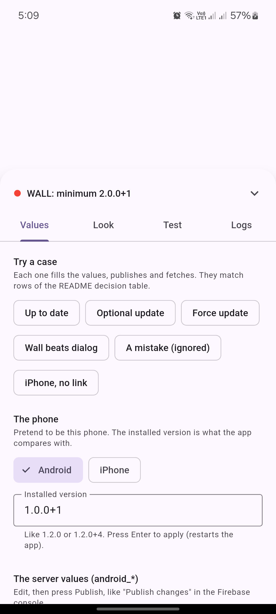

# adaptable_remote_config: example playground

A full app to **try every feature** of the package. No Firebase and no server needed: the
"server", the phone and the store are all simulated inside the app.

<p align="center">
  
  
  
</p>

## Get it

**Android phone (no tools needed):** download `adaptable_remote_config_example.apk` from the
[latest release](https://github.com/Abdelrahman1atef/adaptable_remote_config/releases/latest)
and install it.

**From the source** (needs [Flutter](https://docs.flutter.dev/get-started/install) 3.32+):

```sh
git clone https://github.com/Abdelrahman1atef/adaptable_remote_config.git
cd adaptable_remote_config/example
flutter pub get
flutter run                    # pick a device when asked
```

It runs on Android, iOS, web, Windows, macOS and Linux:

```sh
flutter run -d chrome          # in the browser
flutter run -d windows         # desktop (also: macos, linux)
flutter build apk --release    # an installable Android file
```

## What you see

The screen behind is a pretend app. At the bottom is a **pill** that shows what the package
decided right now (`NOTHING`, `DIALOG` or `WALL`). Tap it to open the **playground**. The
playground sits *above* the update wall, so you can keep changing things while the wall is
showing.

## A 2-minute tour

1. **Open the playground** (tap the pill). Under *Values*, tap **Optional update**.
   The sheet closes and a dialog appears. Try *Later*, then *Skip this version*.
2. Open the playground again and tap **Force update**. The wall appears. It cannot be closed.
3. Tap **Wall beats dialog**: both a minimum and a latest are set, and the wall wins.
4. Tap **A mistake (ignored)**: minimum is above latest. The change is rejected and the last
   good values stay. Open the **Logs** tab: you will see `IGNORED`.
5. Tap **iPhone, no link**: an iPhone with no App Store link cannot show an update at all.
6. Under **Look**, switch to *العربية* and *Right to left*, then open the wall again.
7. Under **Look**, try each level: `appIcon`, `iconBuilder`, `cardBuilder`, own screens.
   The code for your choice is shown at the bottom of that tab.
8. Under **Test**, set the network to *Offline* and press **Fetch now** in *Values*: the app
   keeps its saved values and logs an `ERROR`.

## The tabs

| Tab | What you can do |
| --- | --- |
| **Values** | One-tap cases. Pretend to be an Android phone or an iPhone, and set the installed version. Edit the "server" values (minimum, latest, store link, force, a welcome message) and press **Publish**. **Fetch now** or **Restart app**. See the exact JSON your server would send. |
| **Look** | Level 1 the words (English / Arabic), the app direction, Level 2 the icon, Levels 3 and 4 the card and whole screens, the optional-dialog switches, light/dark. Shows the matching `UpdateGate(...)` code. |
| **Test** | Choose where values live (your own function, or a JSON file served by a fake web server), go offline, make the store fail, simulate Google Play's in-app update, forget the saved copy and the Later/Skip answers. |
| **Logs** | The boxes printed by `RemoteConfigLogger`: **FETCHED** keys, **DECISION** and why, **ACTION** taps, **ERROR** and **IGNORED**. |

Nothing is really opened: the *Update* button only shows a message ("Would open the store:
...") so the demo is safe to tap.

## Where each feature is in the code

| Feature | File |
| --- | --- |
| The gate around the app, all four "look" levels | [`lib/main.dart`](lib/main.dart) |
| Building the controller (provider, keys, store hooks, logger) and the fake server | [`lib/playground_state.dart`](lib/playground_state.dart) |
| Own icon, card and screens (copy these into your app) | [`lib/custom_looks.dart`](lib/custom_looks.dart) |
| Reading another remote value (`welcome_message`) | [`lib/home_page.dart`](lib/home_page.dart) |
| The playground UI | [`lib/panel/`](lib/panel) |

The two sources are shown with the real classes: `CustomConfigProvider` (a function) and
`HttpConfigProvider` (a JSON file, answered here by a fake web server). Firebase works the
same way, but it needs your own Firebase project, so it is not in this demo; see the
[main README](../README.md#method-1-firebase).

## Tests

```sh
flutter test
```

The tests drive the whole app: every case, every look, offline, the store button, Arabic
and right-to-left.
